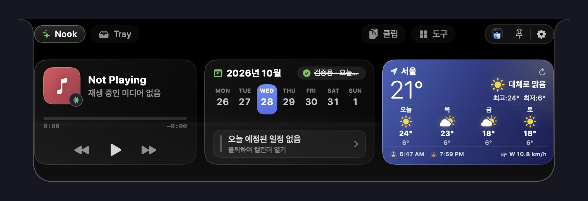

<p align="center">
  
  &nbsp;&nbsp;
  
</p>

<h1 align="center">Notchie — Custom macOS Notch Workspace</h1>

<p align="center">
  <strong>나만의 맞춤형 오픈소스 macOS 노치 워크스페이스 (Custom Edition)</strong>
</p>

<p align="center">
  유휴 노치에 마우스를 올리면 열리는 <strong>파노라마 노치 허브 (Hover Shelf)</strong>, 실시간 <strong>AI 사용량 트래커(Claude Code &amp; Codex)</strong>, 아이폰 다이내믹 아일랜드 특유의 쫄깃한 <strong>Fluid 물리 스프링 모션</strong>, <strong>Face ID급 초고속 얼굴 인식 잠금 해제</strong>, <strong>5-in-1 통합 트레이(파일·캡처·변환·클립보드·AI)</strong>, 그리고 <strong>Apple HIG 규격 아이콘</strong>을 통합한 올인원 macOS 네이티브 앱입니다.
</p>

<p align="center">
  <a href="LICENSE">
    
  </a>
  
  
  
  
</p>

---

## ✨ 핵심 주요 기능 (Key Capabilities)

### 1. 🤖 AI 사용량 트래커 (AI Usage Tracker — Claude Code &amp; OpenAI Codex)
* **터미널 & IDE 작업 중 실시간 HUD**: 별도 창 전환 없이 노치에 마우스를 올리거나 클릭하면 즉시 로컬 AI 코딩 세션과 토큰량을 한눈에 확인합니다.
* **Claude Code 로컬 연동**:
  - `~/.claude/stats-cache.json`을 자동 파싱하여 실시간 입력/출력/캐시 토큰량(`47.7M` 포맷), 총 메시지 수, 세션 수 집계.
  - `~/.claude/history.jsonl`에서 최근 실행 프롬프트 및 프로젝트 폴더, 상대 시간(`2h ago`) 표시 및 원클릭 복사.
* **OpenAI Codex 로컬 연동**:
  - `~/.codex/session_index.jsonl`의 265개 작업 스레드 제목 및 수정 일시 파싱.
  - `~/.codex/config.toml`에서 모델명(`gpt-6.1-sol`), 추론 강도(`low`), 샌드박스 모드 파싱.
* **노치 & 설정 3웨이 접근**:
  - **노치 최상단 헤더 윙**: `[ Nook ] [ 트레이 ] [ AI ]` 원클릭 탭 버튼.
  - **트레이 서브 메뉴**: `[ 파일 트레이 | 스크린샷 기록 | 파일 변환 | 클립보드 | AI 사용량 ]`.
  - **앱 환경설정**: `트레이 설정` → `AI 사용량`에서 통계 확인 및 Finder 폴더 바로가기 제공.

---

### 2. 🌊 Fluid Dynamic Island 모션 피직스 (Apple Spring Physics)
* **Apple Dynamic Island 특유의 쫄깃한 탄력 반동**:
  - `response: 0.38s`, `dampingFraction: 0.68`, `blendDuration: 0.15s`의 정밀한 물리 스프링 파라미터를 적용.
  - 노치 확장/축소, 알림 모핑, 라이브 액티비티 전환 시 살아 움직이는 듯한 유기적인 스쿼시 & 바운스를 선사합니다.
* **모션 스타일 프리셋 선택**:
  - **설정 → 노치 → 모션 및 다이내믹 아일랜드 물리 애니메이션**에서 **`유연한 다이내믹 아일랜드 (Fluid)`**와 **`균형 (Balanced)`** 중 자유롭게 선택할 수 있습니다.

---

### 3. ⚡ Face ID급 초고속 얼굴 인식 잠금 해제 & 눈 깜빡임 생체 인증 (Instant Face Unlock)
* **0.2초대 즉각 인증**: 기존 다중 프레임 대기(3.5초+)를 최적화하여 카메라 웜업 50ms, 30fps 초고속 획득, 검증기 5ms 폴링으로 Face ID급 반응 속도를 달성했습니다.
* **눈 뜸 비율(EAR) & 시선 응시 판별**: Vision 프레임워크 기반 안구 개폐 비율(Eye Openness Ratio)과 정면 응시 각도를 분석하여 사진 및 영상 리플레이 스푸핑 공격을 차단합니다.
* **오리지널 vs 미니멀 노치 미리보기**:
  - **오리지널 (Original)**: 노치 아래로 시원하게 펼쳐지는 풀 배지 스캔 애니메이션.
  - **미니멀 (Minimal)**: 좌우 자물쇠와 콤팩트 스캔 바.
  - 설정 화면에서 실제 노치로 실시간 프리뷰를 전송하는 **`노치에서 미리보기 (Preview in Notch)`** 지원.

---

### 4. 📥 5-in-1 통합 트레이 (Unified Tray Hub)
* 도구와 트레이를 일원화하여 노치 하나에서 5가지 작업을 원클릭으로 전환합니다:
  1. **파일 보관함 (File Tray)**: 임시 드래그 앤 드롭 파일 보관 및 복사/이동.
  2. **스크린샷 기록 (Captures)**: macOS 다중 스크린샷 폴더 자동 감지 및 다국어(`스크린샷`, `화면 캡처`, `Screenshot` 등) 파일명 실시간 모니터링.
  3. **파일 변환 (Transform)**: 기기 내 안전한 이미지/PDF 병합, 배경 투명화(누끼 제거), OCR 텍스트 추출.
  4. **클립보드 히스토리 (Clipboard)**: 노치에서는 최근 10건 스마트 뷰 + `앱 설정에서 더보기…` 오버플로우 링크 제공 (앱 설정에서는 무제한 검색/필터/즐겨찾기 지원).
  5. **AI 사용량 (AI Usage)**: Claude Code 및 OpenAI Codex 실시간 대시보드.
* **자동 닫힘 및 외부 클릭 닫기**: 노치 밖으로 커서가 벗어나거나 외부 영역을 클릭하면 부드럽게 자동 닫힘.

---

### 5. 🎵 6:4 와이드 미디어 &amp; 주간 캘린더 Nook
* **Now Playing 미디어 스튜디오 (60%)**: 앨범 아트워크, 재생 소스 앱 배지, 곡/아티스트 정보, 실시간 이퀄라이저, 인터랙티브 슬림 스크러버 및 재생 컨트롤.
* **주간 7일 캘린더 스트립 (40%)**: 월별 표시 + 주간 7일 스트립(`SUN~SAT`), 예정 일정 확인 및 Google Meet / Zoom 원클릭 **`참여(Join)`** 버튼.
* **원형 전면 카메라 미러 (Camera Mirror)**: 클릭 시에만 활성화되고 노치가 닫히면 안전하게 즉시 꺼지는 실시간 웹캠 거울.

---

### 6. 🎛️ 노치 호버 메뉴 순서 사용자 커스텀 & 경량화
* **불필요한 날씨/골든아워 완전 삭제**: 리소스를 점유하던 백그라운드 날씨 폴링을 제거하여 극도로 가볍고 빠른 반응성 확보.
* **노치 탭 순서 커스터마이징**: 노치 호버 탭 바의 위치/순서를 ◀ / ▶ 버튼과 토글을 통해 사용자가 원하는 순서대로 자유롭게 배치.

---

### 7. 🎨 Apple HIG 표준 앱 아이콘 & 다크/라이트 테마 연동
* 1024×1024 캔버스 중심에 824×824 pt(80.5% 비율) 스퀘어클과 100pt 상하좌우 여백, 듀얼 드롭 섀도우를 내장하여 Dock 및 Finder에서 다른 macOS 앱과 완벽한 일체감을 제공합니다.
* 시스템 테마에 맞춰 **밝은 실버 글래스 아이콘(Light)**과 **옵시디언 다크 아이콘(Dark)**으로 자동 전환되거나 고정할 수 있습니다.
* 8종 프리셋 및 시스템 컬러 피커를 통해 노치 강조 색상(`customAccentColorHex`)을 자유롭게 커스텀할 수 있습니다.

---

### 8. 🛡️ 앱 시작 시 권한 자동 점검 가드 (Startup Permission Guard)
* 앱 시작 시 필수 권한(손쉬운 사용, 카메라, 블루투스, 캘린더 등) 상태를 점검합니다.
* 미허용 권한 발견 시 노치 상단 배너 알림 및 시스템 안내 팝업을 띄워 원클릭으로 권한 설정 페이지로 이동할 수 있도록 돕습니다.

---

## 📸 스크린샷 (Screenshots)

### 0) OS 27 파노라마 노치 허브 (Now Playing + 7일 캘린더 + 트레이 / AI 탭)
<p align="center">
  
</p>

### 1) 일반 → 정보 (Notchie Custom Edition)
<p align="center">
  
</p>

### 2) 얼굴 잠금 해제 — 오리지널 배지 vs 미니멀 스타일 미리보기
<p align="center">
  
</p>

### 3) 노치 호버 메뉴 탭 설정 & 클립보드 히스토리 실시간 검색
<p align="center">
  
</p>

### 4) 화면 테마 & 맞춤 강조 색상 (Custom Accent Color)
<p align="center">
  
</p>

### 5) 권한 관리 & 앱 시작 시 필수 권한 확인/알람
<p align="center">
  
</p>

---

## 🌐 프로젝트 소개 웹페이지 (Documentation Webpage)

저장소의 [`docs/index.html`](docs/index.html)에 라이트/다크 자동 대응(`color-scheme: light dark`, CSS `light-dark()`)이 적용된 **Notchie 소개 웹페이지**가 포함되어 있습니다.  
GitHub Pages를 활성화(`docs/` 폴더 기준)하거나 브라우저에서 `docs/index.html`을 직접 열어 미려한 인터랙티브 쇼케이스를 확인하실 수 있습니다.

---

## 🛠️ 빌드 및 설치 방법 (Build & Install)

### 요구 사항 (Requirements)
* macOS 14.6 이상 (노치가 있는 MacBook 및 일반 모니터의 Dynamic Island 캡슐 모드 모두 지원)
* Xcode 16+

### 커맨드라인 테스트 및 로컬 설치
```bash
# 1. 단위 테스트 실행 (306개 DynamicNotch 테스트 + 104개 HeyMac 테스트)
./scripts/test-app.sh

# 2. Release 빌드 컴파일
xcodebuild -project DynamicNotch.xcodeproj \
  -scheme DynamicNotch \
  -configuration Release \
  -derivedDataPath build/DynamicNotch-release \
  CODE_SIGNING_ALLOWED=NO build

# 3. /Applications/Notchie.app 설치 및 코드 서명 엄격 검증
./scripts/install-local.sh build/DynamicNotch-release/Build/Products/Release/DynamicNotch.app
```

---

## 📄 오픈소스 라이선스 및 기반 프로젝트 (Open Source & Credits)

**Notchie**는 오픈소스 프로젝트들을 기반으로 다양한 맞춤 기능을 직접 추가·개선하여 제작한 커스텀 에디션이며, 원저작자의 라이선스 고지를 준수하여 **GNU General Public License v3.0 (GPL-3.0)**으로 배포됩니다.

* **[DynamicNotch](https://github.com/jackson-storm/DynamicNotch)** (`GPL-3.0`) — macOS Dynamic Notch 엔진 및 시스템 HUD 기반 아키텍처
* **[HeyMac](https://github.com/iharshitmaurya/HeyMac)** (`MIT License`) — 카메라 얼굴 인식 잠금 해제 및 앱 프라이버시 보호 엔진 (`Vendor/HeyMac`)
* **[Lottie for iOS/macOS](https://github.com/airbnb/lottie-ios)** (`Apache-2.0`) — 벡터 애니메이션 렌더링

자세한 라이선스 전문은 [LICENSE](LICENSE) 및 [LOCAL_CHANGES.md](LOCAL_CHANGES.md)를 참고하세요.
