<p align="center">
  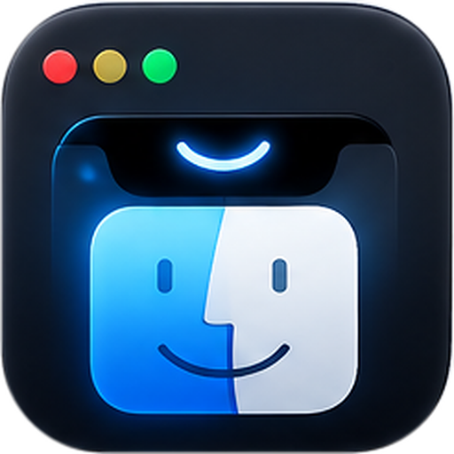
  &nbsp;&nbsp;
  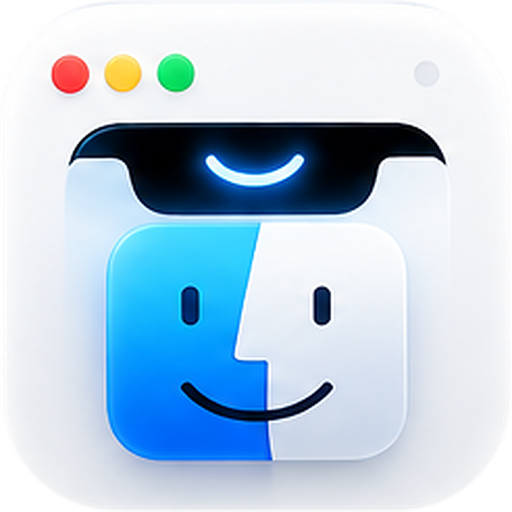
</p>

<h1 align="center">Notchie — Custom macOS Notch Workspace</h1>

<p align="center">
  <strong>나만의 맞춤형 오픈소스 macOS 노치 워크스페이스 (Custom Edition)</strong>
</p>

<p align="center">
  노치에 마우스를 올리면 열리는 <strong>파노라마 노치 허브</strong>에 Now Playing·실시간 가사·사운드 믹서, 주간 캘린더, <strong>영화·OTT 개봉 캘린더</strong>, 통화 중 자동으로 뜨는 <strong>미팅 컨트롤</strong>, <strong>AI 사용량 트래커(Claude Code &amp; Codex)</strong>, 통합 트레이, 얼굴 잠금 해제를 담은 macOS 네이티브 앱입니다.
</p>

<p align="center">
  <a href="LICENSE">
    
  </a>
  
  
  
  
</p>

---

## ✨ 주요 기능 (Key Capabilities)

| | 기능 | 한 줄 요약 |
| --- | --- | --- |
| 🎵 | [Now Playing · 가사 · 사운드 믹서](#1--now-playing-실시간-가사--앱별-사운드-믹서) | 앨범 아트·스크러버, 실시간 싱크 가사, 앱별 볼륨 |
| 📅 | [주간 캘린더 Nook](#2--주간-캘린더-nook) | 7일 스트립, 다음 일정, 원클릭 회의 참여 |
| 🎬 | [영화·OTT 개봉 캘린더](#3--영화ott-예고편--개봉-캘린더) | 극장/넷플릭스/디즈니+/Apple TV+ 개봉일, D-day, 캘린더 등록 |
| 📹 | [미팅 컨트롤](#4--미팅-컨트롤-google-meet--zoom--teams) | 통화 중 자동 라이브 액티비티, 마이크·카메라·나가기 |
| 💬 | [메시지 빠른 답장](#5--메시지-알림--빠른-답장) | 노치에서 바로 답장과 이모지 반응 |
| 🤖 | [AI 사용량 트래커](#6--ai-사용량-트래커-claude-code--openai-codex) | Claude Code · Codex 토큰, 세션, 한도 |
| 📥 | [통합 트레이](#7--통합-트레이-unified-tray-hub) | 파일 · 스크린샷 · 변환 · 클립보드 |
| 🔐 | [얼굴 잠금 해제](#8--얼굴-잠금-해제-face-unlock) | 카메라 기반 잠금 해제와 노치 미리보기 |
| 🌊 | [Fluid 스프링 모션](#9--fluid-dynamic-island-모션) | 다이내믹 아일랜드 느낌의 탄성 애니메이션 |
| 🎨 | [테마 · 아이콘 · 권한 점검](#10--테마--아이콘--권한-점검) | 다크/라이트 아이콘, 강조 색상, 시작 시 권한 확인 |

---

### 1. 🎵 Now Playing, 실시간 가사 & 앱별 사운드 믹서
* **Now Playing 스튜디오**: 앨범 아트워크, 재생 앱 배지, 곡/아티스트, 이퀄라이저, 슬림 스크러버와 재생 컨트롤.
* **실시간 싱크 가사**: 여러 가사 소스를 차례로 시도하고 제목을 정규화(괄호 부제, feat., 리마스터 표기 등)해서 찾습니다. 카드 아무 곳이나 클릭하면 가사가 켜지고 꺼집니다.
* **앱별 사운드 믹서**: Now Playing 카드의 컴퓨터 버튼으로 캘린더 자리에 믹서를 엽니다. 마스터/마이크 볼륨과 음소거, 오디오를 재생 중인 앱 목록, 세로 슬라이더, 호버 스크롤로 볼륨 조절.

### 2. 📅 주간 캘린더 Nook
* 월 표시와 7일 스트립(`SUN~SAT`), 다음 일정 카드, Google Meet / Zoom **`참여(Join)`** 버튼.
* 아래로 스크롤하거나 한 번 클릭하면 전체 일정이 열리고, 위로 스크롤하거나 다시 클릭하면 닫힙니다.

### 3. 🎬 영화·OTT 예고편 & 개봉 캘린더
* 노치 상단 설정 버튼 옆 **`🎬`** 탭. 극장 개봉작과 Netflix · Disney+ · Apple TV+ 공개작을 한곳에서 봅니다.
* 플랫폼 필터, **`전체 / 개봉 예정 / 연도별`** 기간 필터(데이터에 있는 연도로 자동 생성), 검색, 날짜를 고르는 개봉 캘린더.
* D-day 배지(`D-3`, `D-DAY`, `절찬 상영`, `스트리밍 중`), **`▶ 예고편`**(확인된 링크가 없으면 YouTube 검색), **`📅 캘린더 등록`**(.ics 종일 일정).
* 데이터는 앱에 내장된 [`cinema_releases.json`](DynamicNotch/Resources/cinema_releases.json)을 쓰고, 새로고침하면 이 저장소의 최신 JSON을 받아옵니다. 받아오지 못하면 `오프라인`으로 표시하고 내장 데이터를 그대로 보여 줍니다.

### 4. 📹 미팅 컨트롤 (Google Meet · Zoom · Teams)
* 통화가 시작되면 노치에 미팅 라이브 액티비티가 자동으로 떠서 **마이크 음소거, 카메라, 통화 종료, 창 열기** 버튼을 보여 줍니다.
* **마이크가 실제로 사용 중일 때만** 통화로 판단합니다. 그래서 Zoom이 백그라운드에 켜져 있기만 하거나 Meet 홈 탭만 열려 있을 때는 뜨지 않습니다. 브라우저 Meet 탭은 회의 코드가 있는 주소(`meet.google.com/abc-defg-hij`)만 통화로 인식합니다.
* 감지가 잠깐 끊겨도 바로 닫히지 않고, `나가기`를 누르면 같은 통화가 끝날 때까지 다시 뜨지 않습니다.

### 5. 💬 메시지 알림 & 빠른 답장
* 메시지, Slack 등의 알림을 노치에 띄우고, 그 자리에서 답장하거나 이모지(`👍 ❤️ 😂 🎉 🙏 🔥`)로 반응합니다.

### 6. 🤖 AI 사용량 트래커 (Claude Code & OpenAI Codex)
* 노치 상단 **AI** 탭에서 로컬 AI 코딩 세션과 토큰 사용량을 바로 확인합니다.
* **Claude Code**: `~/.claude/stats-cache.json`의 입력/출력/캐시 토큰(`47.7M` 형식), 메시지·세션 수, `~/.claude/history.jsonl`의 최근 프롬프트와 프로젝트, 상대 시간(`2h ago`), 원클릭 복사.
* **OpenAI Codex**: `~/.codex/session_index.jsonl`의 작업 스레드, `~/.codex/config.toml`의 모델·추론 강도·샌드박스 모드, 한도 소진 감지.
* 모든 데이터는 로컬 파일에서만 읽고, 외부로 보내지 않습니다.

### 7. 📥 통합 트레이 (Unified Tray Hub)
1. **파일 보관함**: 드래그 앤 드롭으로 파일을 잠시 맡겨 두고 복사/이동.
2. **스크린샷 기록**: 여러 스크린샷 폴더를 자동으로 찾고 `스크린샷`, `화면 캡처`, `Screenshot` 같은 다국어 파일명을 감시.
3. **파일 변환**: 기기 안에서 이미지/PDF 병합, 배경 제거, OCR 텍스트 추출.
4. **클립보드 히스토리**: 노치에는 최근 10개, 앱 설정에는 전체 기록과 검색·즐겨찾기.
* 노치 밖으로 커서가 나가거나 바깥을 클릭하면 자동으로 닫힙니다.

### 8. 🔐 얼굴 잠금 해제 (Face Unlock)
* 카메라 웜업 50ms, 30fps 획득, 5ms 폴링으로 빠르게 인식합니다.
* Vision 기반 눈 뜸 비율(EAR)과 시선 방향을 확인해 사진·영상 재생 공격을 줄입니다.
* **오리지널**(노치 아래로 펼쳐지는 배지 스캔)과 **미니멀**(좌우 자물쇠 + 콤팩트 스캔 바) 스타일, **`노치에서 미리보기`** 지원.
* ⚠️ Mac의 일반 카메라를 쓰는 편의 기능이며 **Apple Face ID 수준의 보안 장치가 아닙니다.** 기본값은 꺼져 있고, 직접 등록해야 켜집니다.

### 9. 🌊 Fluid Dynamic Island 모션
* `response: 0.38s`, `dampingFraction: 0.68`, `blendDuration: 0.15s` 스프링으로 노치 확장/축소, 알림 모핑, 라이브 액티비티 전환에 탄성을 줍니다.
* **설정 → 노치 → 모션**에서 `유연한 다이내믹 아일랜드 (Fluid)`와 `균형 (Balanced)` 중에서 고를 수 있습니다.

### 10. 🎨 테마 · 아이콘 · 권한 점검
* Apple HIG 규격(1024 캔버스 안 824pt 스퀘어클) 앱 아이콘. 시스템 테마에 따라 **라이트(실버 글래스)** / **다크(옵시디언)** 아이콘이 바뀌거나 하나로 고정할 수 있습니다.
* 8가지 프리셋과 컬러 피커로 노치 강조 색상(`customAccentColorHex`)을 바꿀 수 있습니다.
* 노치 호버 탭 순서를 ◀ / ▶ 버튼과 토글로 바꿀 수 있습니다.
* 앱을 시작할 때 손쉬운 사용, 카메라, 블루투스, 캘린더 등 권한 상태를 확인하고, 빠진 권한이 있으면 노치 배너와 안내 창으로 설정 페이지까지 안내합니다. 권한을 대신 켜지는 않습니다.

---

## 📸 스크린샷 (Screenshots)

> 아래 이미지는 모두 실제 앱 화면 캡처입니다. 최근 추가된 기능(🎬 영화·OTT, 미팅 컨트롤, AI 탭 등)의 캡처는 아직 없어서 [캡처 예정 목록](#-새-기능-스크린샷-캡처-방법)에 정리해 두었습니다.

### 노치 라이브 액티비티 & 시스템 HUD

DynamicNotch 엔진에서 물려받아 Notchie에서도 그대로 동작하는 알림들입니다. (캡처 출처: upstream DynamicNotch)

<p align="center">
  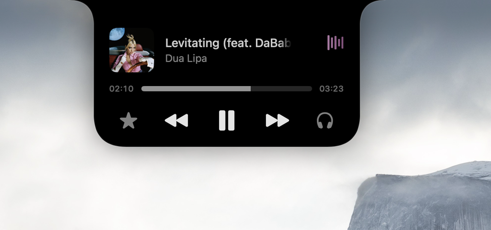
</p>

<table>
  <tr>
    <td align="center">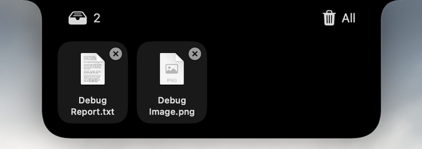<br/><sub>파일 트레이 (드래그 앤 드롭)</sub></td>
    <td align="center">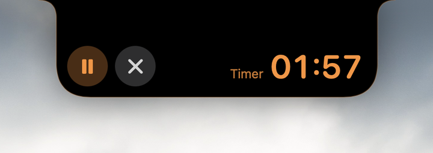<br/><sub>타이머</sub></td>
  </tr>
  <tr>
    <td align="center">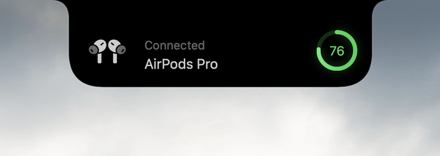<br/><sub>블루투스 기기 연결 · 배터리</sub></td>
    <td align="center">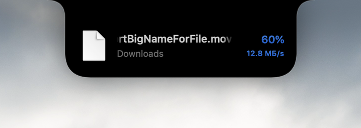<br/><sub>다운로드 진행률</sub></td>
  </tr>
  <tr>
    <td align="center">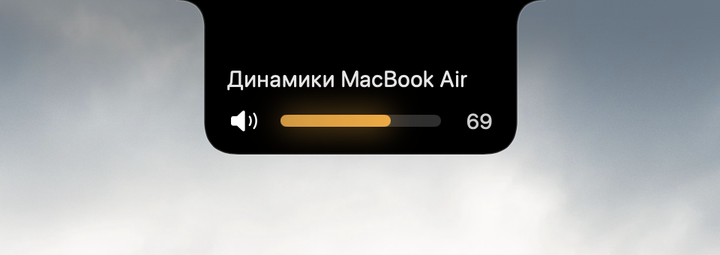<br/><sub>볼륨 HUD</sub></td>
    <td align="center">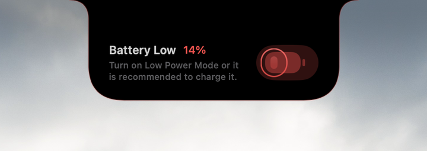<br/><sub>배터리 부족 알림</sub></td>
  </tr>
  <tr>
    <td align="center">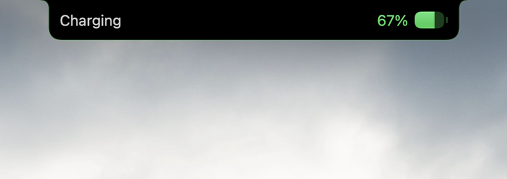<br/><sub>충전 상태</sub></td>
    <td align="center">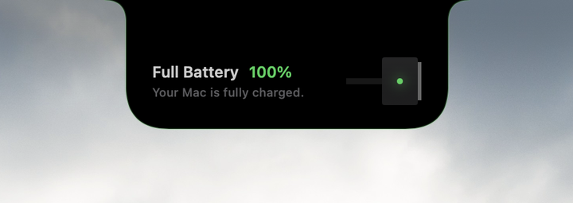<br/><sub>완충 알림</sub></td>
  </tr>
  <tr>
    <td align="center">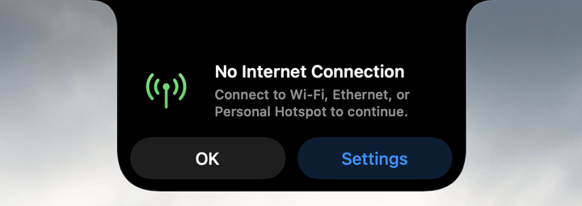<br/><sub>인터넷 연결 끊김</sub></td>
    <td align="center">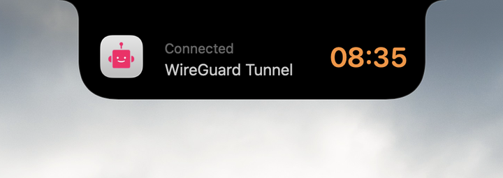<br/><sub>VPN 연결 시간</sub></td>
  </tr>
  <tr>
    <td align="center">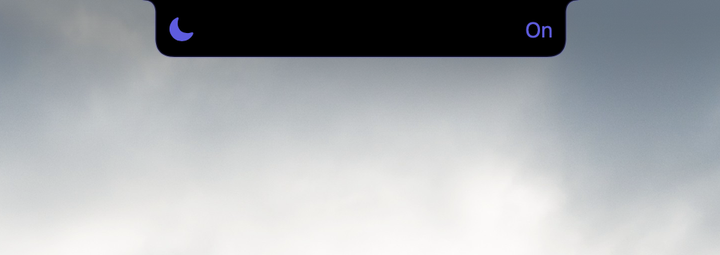<br/><sub>집중 모드</sub></td>
    <td align="center">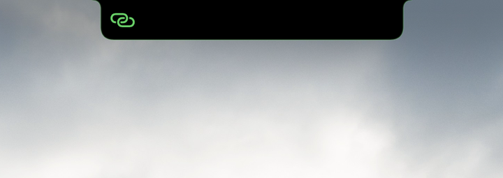<br/><sub>개인용 핫스팟</sub></td>
  </tr>
</table>

<details>
<summary>잠금 화면 미디어 위젯 보기</summary>
<p align="center">
  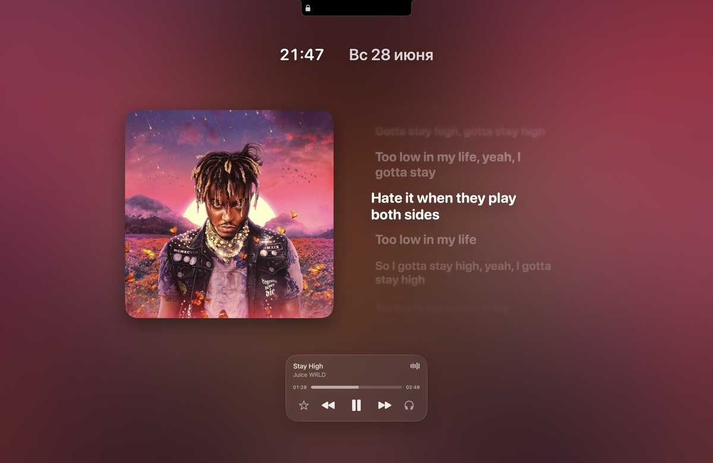
</p>
</details>

### Notchie 설정 화면

<table>
  <tr>
    <td align="center" width="50%">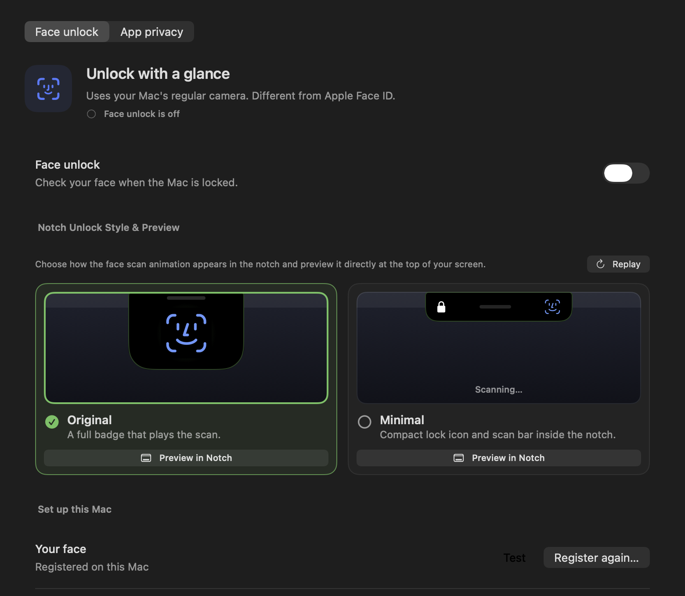<br/><sub>얼굴 잠금 해제 — 오리지널 배지 vs 미니멀 스타일</sub></td>
    <td align="center" width="50%">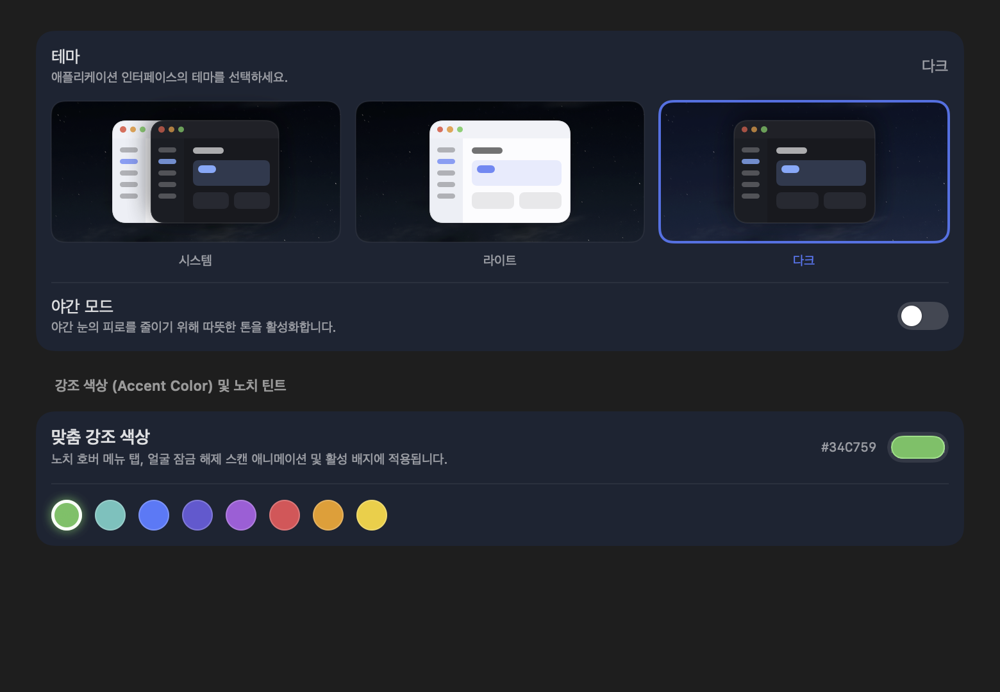<br/><sub>테마 · 다크/라이트 앱 아이콘 · 강조 색상</sub></td>
  </tr>
  <tr>
    <td align="center">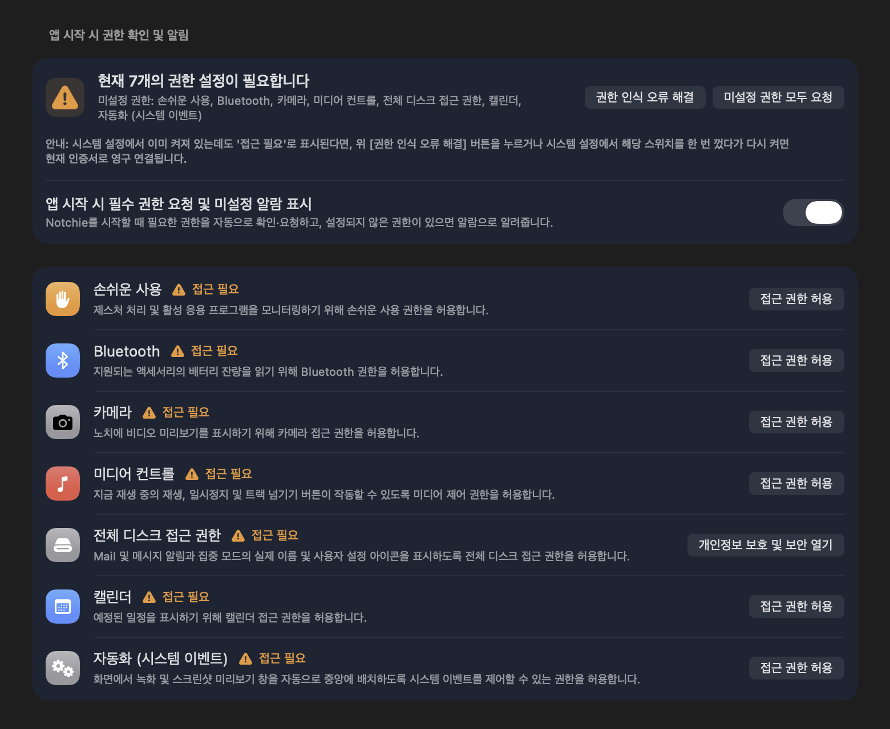<br/><sub>앱 시작 시 권한 점검 & 알림</sub></td>
    <td align="center">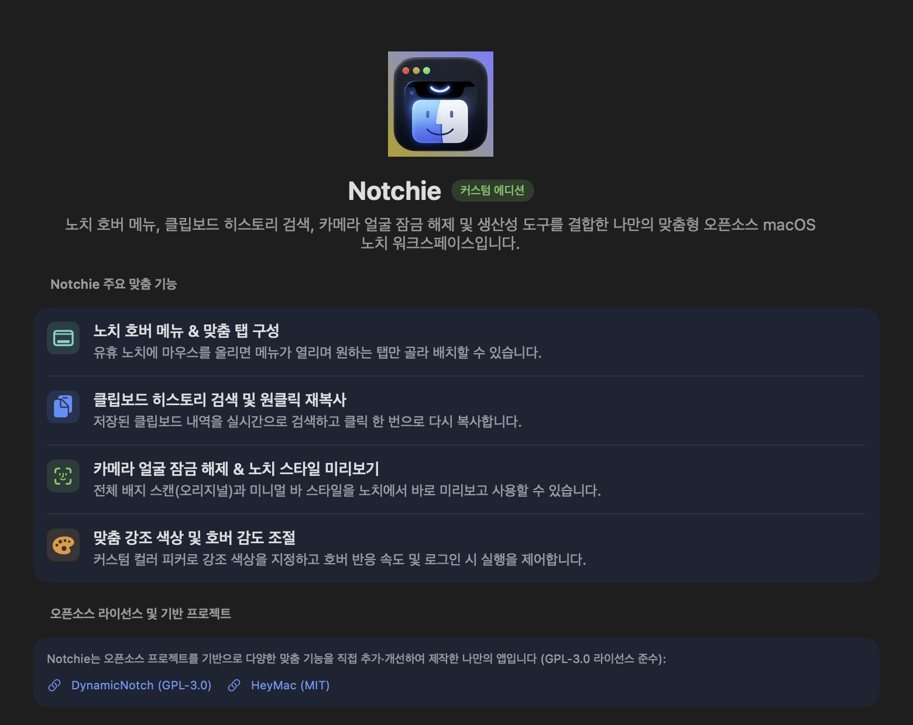<br/><sub>일반 → 정보 (Notchie Custom Edition)</sub></td>
  </tr>
</table>

### 📷 새 기능 스크린샷 캡처 방법

다음 화면은 아직 캡처가 없습니다. Mac에서 아래 스크립트를 실행하면 화면 상단 노치 영역을 `docs/screenshots/<이름>.png`로 저장합니다. (스크립트를 실행하는 터미널 앱에 화면 기록 권한이 필요합니다.)

```bash
./scripts/capture-readme-screenshots.sh                  # 전체 순서대로
./scripts/capture-readme-screenshots.sh cinema-trailers  # 특정 화면만
```

| 이름 | 캡처할 화면 |
| --- | --- |
| `panoramic-notch-hub` | 노치 호버 → Nook 홈 (Now Playing + 캘린더 + 탭 바) |
| `cinema-trailers` | 🎬 영화·OTT 탭 |
| `meeting-controls` | Google Meet / Zoom 통화 중 미팅 라이브 액티비티 |
| `ai-usage` | AI 탭 (Claude Code / Codex 사용량 카드) |
| `synced-lyrics` | Now Playing 실시간 가사 |
| `sound-mixer` | 앱별 사운드 믹서 |
| `unified-tray` | 통합 트레이 (파일 · 캡처 · 변환 · 클립보드) |

> 커밋하기 전에 클립보드 내용, 메시지, 캘린더 일정 제목 같은 개인 정보가 찍히지 않았는지 꼭 확인하세요.

---

## 🌐 프로젝트 소개 웹페이지 (Documentation Webpage)

저장소의 [`docs/index.html`](docs/index.html)에는 라이트/다크 모드에 자동으로 맞춰지는(`color-scheme: light dark`, CSS `light-dark()`) **Notchie 소개 웹페이지**가 들어 있습니다.
GitHub Pages를 `docs/` 폴더 기준으로 켜거나, 브라우저에서 `docs/index.html`을 직접 열어 보세요.

---

## 🛠️ 빌드 및 설치 방법 (Build & Install)

### 요구 사항 (Requirements)
* macOS 14.6 이상 (노치가 있는 MacBook 및 일반 모니터의 Dynamic Island 캡슐 모드 모두 지원)
* Xcode 16+

### 커맨드라인 테스트 및 로컬 설치
```bash
# 1. 단위 테스트 실행 (DynamicNotch + HeyMac 테스트)
./scripts/test-app.sh

# 2. Release 빌드 컴파일
xcodebuild -project DynamicNotch.xcodeproj \
  -scheme DynamicNotch \
  -configuration Release \
  -derivedDataPath build/DynamicNotch-release \
  CODE_SIGNING_ALLOWED=NO build

# 3. /Applications/Notchie.app 설치 및 코드 서명 엄격 검증
./scripts/install-local.sh build/DynamicNotch-release/Build/Products/Release/DynamicNotch.app
```

---

## 📄 오픈소스 라이선스 및 기반 프로젝트 (Open Source & Credits)

**Notchie**는 오픈소스 프로젝트들을 기반으로 다양한 맞춤 기능을 직접 추가·개선하여 제작한 커스텀 에디션이며, 원저작자의 라이선스 고지를 준수하여 **GNU General Public License v3.0 (GPL-3.0)**으로 배포됩니다.

* **[DynamicNotch](https://github.com/jackson-storm/DynamicNotch)** (`GPL-3.0`) — macOS Dynamic Notch 엔진 및 시스템 HUD 기반 아키텍처
* **[HeyMac](https://github.com/iharshitmaurya/HeyMac)** (`MIT License`) — 카메라 얼굴 인식 잠금 해제 및 앱 프라이버시 보호 엔진 (`Vendor/HeyMac`)
* **[Lottie for iOS/macOS](https://github.com/airbnb/lottie-ios)** (`Apache-2.0`) — 벡터 애니메이션 렌더링

자세한 라이선스 전문은 [LICENSE](LICENSE) 및 [LOCAL_CHANGES.md](LOCAL_CHANGES.md)를 참고하세요.
