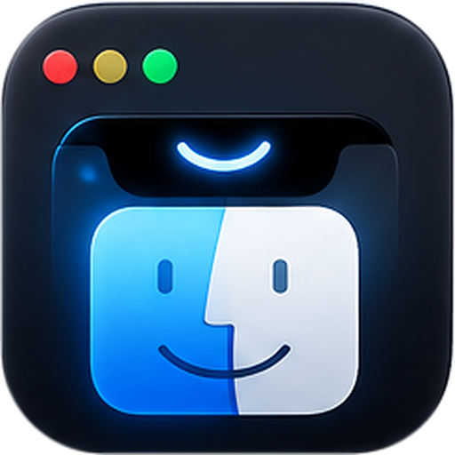
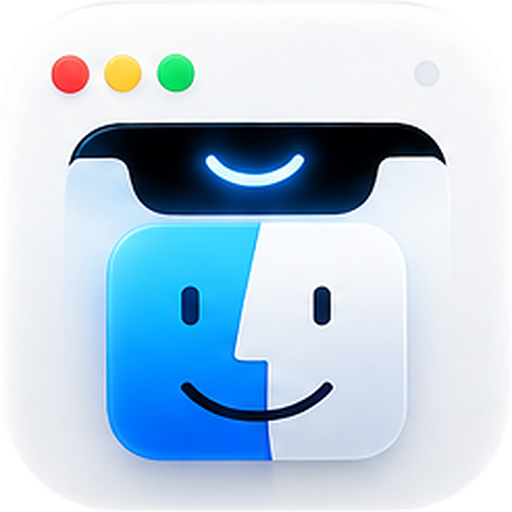
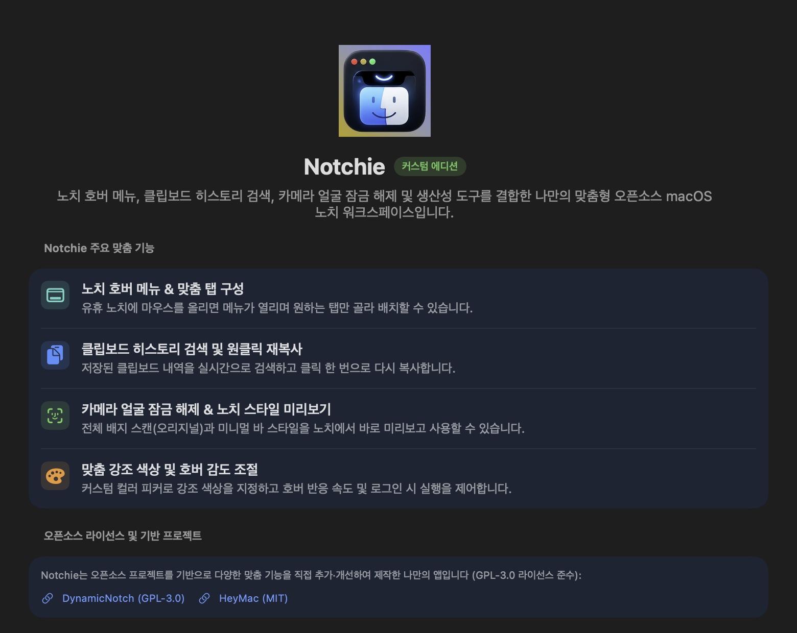
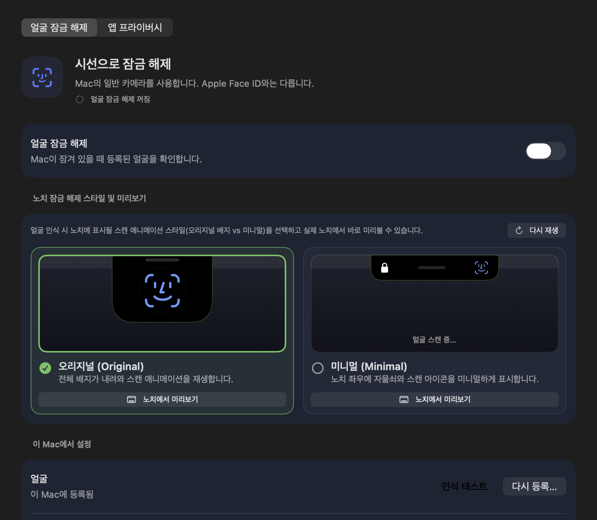
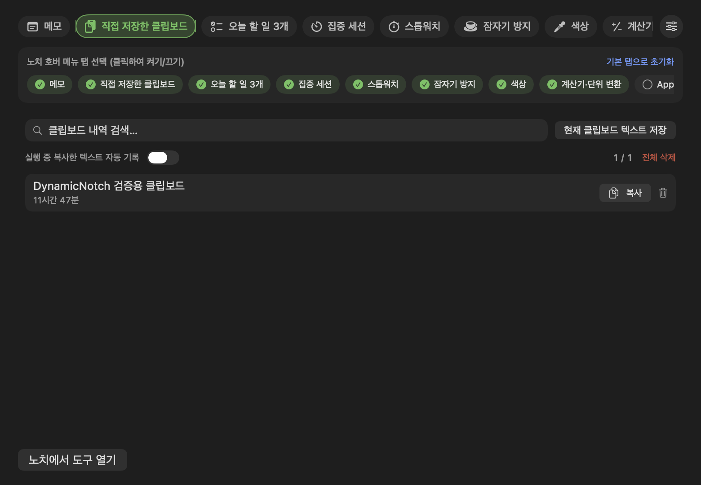
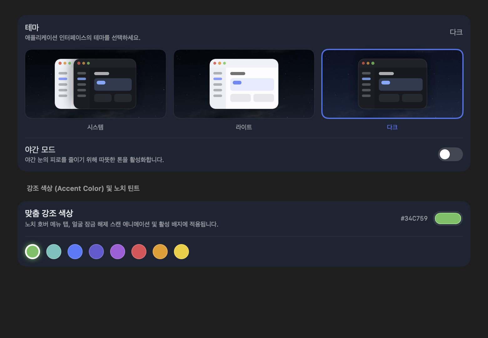
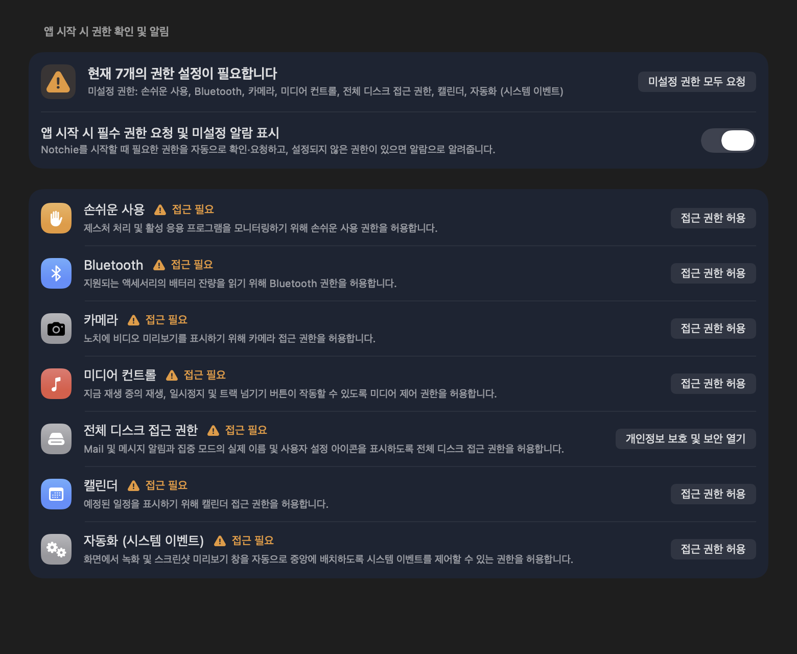

<p align="center">
  
  &nbsp;&nbsp;
  
</p>

<h1 align="center">Notchie — Custom macOS Notch Workspace</h1>

<p align="center">
  <strong>나만의 맞춤형 오픈소스 macOS 노치 워크스페이스 (Custom Edition)</strong>
</p>

<p align="center">
  유휴 노치에 마우스를 올리면 열리는 <strong>NotchNook 스타일 호버 메뉴 (Hover Shelf)</strong>, 실시간 <strong>클립보드 히스토리 검색 및 원클릭 재복사</strong>, <strong>카메라 얼굴 잠금 해제 (Original 풀 배지 스캔 &amp; Minimal 프리뷰)</strong>, <strong>커스텀 강조 색상 피커</strong>, 그리고 <strong>앱 시작 시 필수 권한 자동 확인·알림</strong>을 통합한 macOS 네이티브 앱입니다.
</p>

<p align="center">
  <a href="LICENSE">
    
  </a>
  
  
</p>

---

## ✨ 주요 커스텀 기능 (What's New in Notchie)

### 1. 🧲 노치 호버 메뉴 & 맞춤 탭 구성 (Notch Hover Shelf)
- 라이브 액티비티가 없는 유휴(Idle) 상태에서도 상단 노치에 마우스를 올리면(`isIdleNotchHoverMenuEnabled`) 즉시 **빠른 도구 허브(Notch Hub)**가 펼쳐집니다.
- 상단 가로형 아이콘 탭 바와 **표시할 탭 선택(Tab Customizer)** 기능을 통해 원하는 탭(메모, 클립보드, 오늘 할 일, 집중 세션, 스톱워치, 잠자기 방지, 색상 추출, 계산기, 단축어, ZIP, 개발자 도구 등)만 골라 배치할 수 있습니다.
- 노치 내부 **고정(Pin)** 버튼(`isNotchHubPinned`)으로 마우스가 노치 밖으로 이동해도 창을 닫지 않고 유지할 수 있습니다.

### 2. 📋 클립보드 히스토리 검색 & 원클릭 재복사 (Clipboard History & Search)
- 복사한 모든 텍스트 내역을 **실시간 검색창(`Search clipboard history…`)**으로 즉시 필터링합니다.
- 원하는 항목이나 복사 버튼을 클릭하면 클립보드에 즉시 다시 복사되며 **`복사됨! (Copied!)`** 시각 피드백이 표시됩니다.
- **실행 중 복사한 텍스트 자동 기록(`isAutoCaptureClipboardEnabled`)** 옵션을 지원하며, 비밀번호·민감 데이터(`ConcealedType` / `AutoGeneratedType`)는 자동으로 제외합니다.

### 3. 🪪 카메라 얼굴 잠금 해제 & 오리지널/미니멀 노치 미리보기 (Face Unlock & Live Preview)
- [HeyMac](https://github.com/iharshitmaurya/HeyMac) 엔진을 통합하여 카메라 기반 얼굴 잠금 해제 및 선택 앱 프라이버시 가림막(App Privacy Cover)을 지원합니다.
- **노치 잠금 해제 스타일 선택 및 실시간 미리보기**:
  - **오리지널 (Original)**: 전체 배지가 노치 아래로 확장되며 스캔 애니메이션을 재생합니다 (*"A full badge that plays the scan."*).
  - **미니멀 (Minimal)**: 노치 좌우에 자물쇠 아이콘과 스캔 애니메이션을 컴팩트하게 표시합니다.
  - 설정 화면에서 두 스타일을 나란히 실시간 비교하고 **`노치에서 미리보기 (Preview in Notch)`** 버튼으로 상단 실제 노치에서 즉시 테스트할 수 있습니다.

### 4. 🎨 맞춤 강조 색상 (Custom Accent Color) & 호버 감도 조절
- **일반 → 화면 테마**에서 8종의 프리셋 컬러칩과 macOS 기본 `ColorPicker`를 사용해 원하는 강조 색상(`customAccentColorHex`)을 자유롭게 지정할 수 있습니다.
- 선택한 강조 색상은 노치 호버 메뉴 탭, 얼굴 잠금 해제 스캔 애니메이션, 상태 배지에 일관되게 반영됩니다.
- 호버 반응 지연 시간(Hover Sensitivity), 로그인 시 실행(Launch at Login), 앱별 자동 표시 규칙 등을 세밀하게 제어할 수 있습니다.

### 5. 🛡️ 앱 시작 시 필수 권한 자동 점검 및 미설정 알람 (Startup Permission Guard)
- 앱 시작 시 손쉬운 사용(Accessibility), 카메라, 블루투스, 미디어 컨트롤, 캘린더, 자동화(System Events) 등 필수 권한 상태를 확인하고 미결정 권한을 요청합니다.
- 아직 허용되지 않은 권한이 남아 있으면 **노치 상단 배너 알림**과 함께 **권한 설정 안내 알람(`NSAlert`)**을 띄워 미설정 항목을 안내하고 **권한 설정 페이지**로 바로 이동할 수 있도록 돕습니다.

---

## 📸 스크린샷 (Screenshots)

### 1) 일반 → 정보 (Notchie Custom Edition)
<p align="center">
  
</p>

### 2) 얼굴 잠금 해제 — 오리지널 배지 vs 미니멀 스타일 미리보기
<p align="center">
  
</p>

### 3) 노치 호버 메뉴 탭 설정 & 클립보드 히스토리 실시간 검색
<p align="center">
  
</p>

### 4) 화면 테마 & 맞춤 강조 색상 (Custom Accent Color)
<p align="center">
  
</p>

### 5) 권한 관리 & 앱 시작 시 필수 권한 확인/알람
<p align="center">
  
</p>

---

## 🌐 프로젝트 소개 웹페이지 (Documentation Webpage)

저장소의 [`docs/index.html`](docs/index.html)에 라이트/다크 자동 대응(`color-scheme: light dark`, CSS `light-dark()`)이 적용된 **Notchie 소개 웹페이지**가 포함되어 있습니다.
GitHub Pages를 활성화(`docs/` 폴더 기준)하거나 브라우저에서 `docs/index.html`을 직접 열어 확인할 수 있습니다.

---

## 🛠️ 빌드 및 설치 방법 (Build & Install)

### 요구 사항 (Requirements)
- macOS 14.6 이상 (노치가 있는 MacBook 및 일반 모니터의 Dynamic Island 캡슐 모드 모두 지원)
- Xcode 16+

### 커맨드라인 테스트 및 로컬 설치
```bash
# 1. 단위 테스트 실행
xcodebuild -project DynamicNotch.xcodeproj \
  -scheme DynamicNotch \
  -destination 'platform=macOS' \
  -derivedDataPath build/DerivedData \
  CODE_SIGNING_ALLOWED=NO test

# 2. Release 빌드 생성
xcodebuild -project DynamicNotch.xcodeproj \
  -scheme DynamicNotch \
  -configuration Release \
  -derivedDataPath build/DerivedData \
  CODE_SIGNING_ALLOWED=NO build

# 3. /Applications 설치 및 ad-hoc 서명 검증
./scripts/install-local.sh build/DerivedData/Build/Products/Release/DynamicNotch.app
```

---

## 📄 오픈소스 라이선스 및 기반 프로젝트 (Open Source & Credits)

**Notchie**는 오픈소스 프로젝트들을 기반으로 다양한 맞춤 기능을 직접 추가·개선하여 제작한 커스텀 에디션이며, 원저작자의 라이선스 고지를 준수하여 **GNU General Public License v3.0 (GPL-3.0)**으로 배포됩니다.

- **[DynamicNotch](https://github.com/jackson-storm/DynamicNotch)** (`GPL-3.0`) — macOS Dynamic Notch 엔진 및 시스템 HUD 기반 아키텍처
- **[HeyMac](https://github.com/iharshitmaurya/HeyMac)** (`MIT License`) — 카메라 얼굴 인식 잠금 해제 및 앱 프라이버시 보호 엔진 (`Vendor/HeyMac`)
- **[Lottie for iOS/macOS](https://github.com/airbnb/lottie-ios)** (`Apache-2.0`) — 벡터 애니메이션 렌더링

자세한 라이선스 전문은 [LICENSE](LICENSE) 및 [LOCAL_CHANGES.md](LOCAL_CHANGES.md)를 참고하세요.
